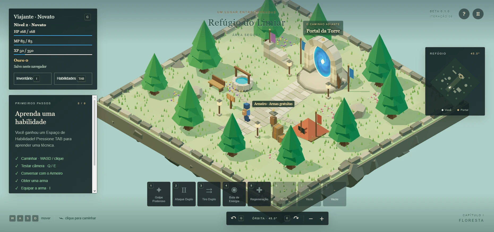
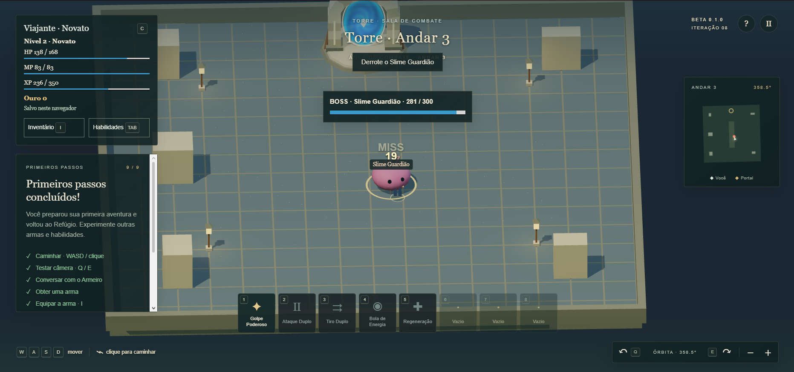
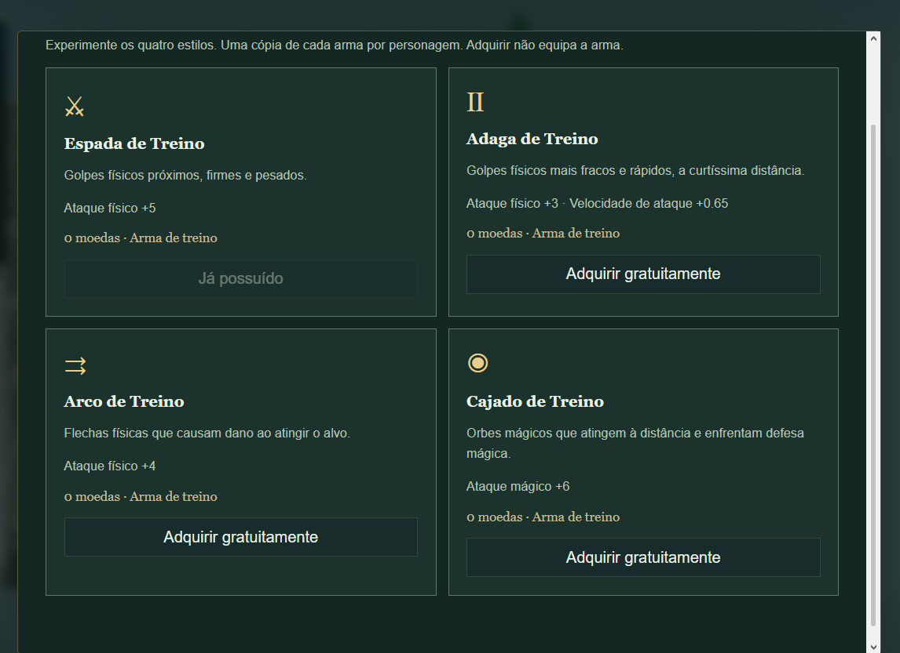
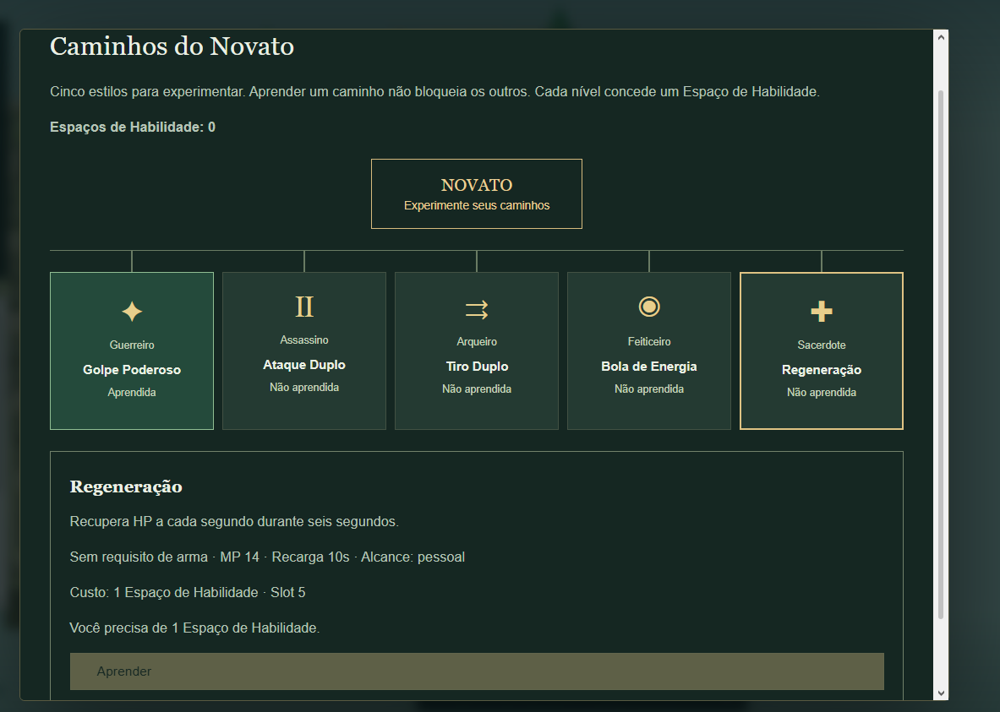
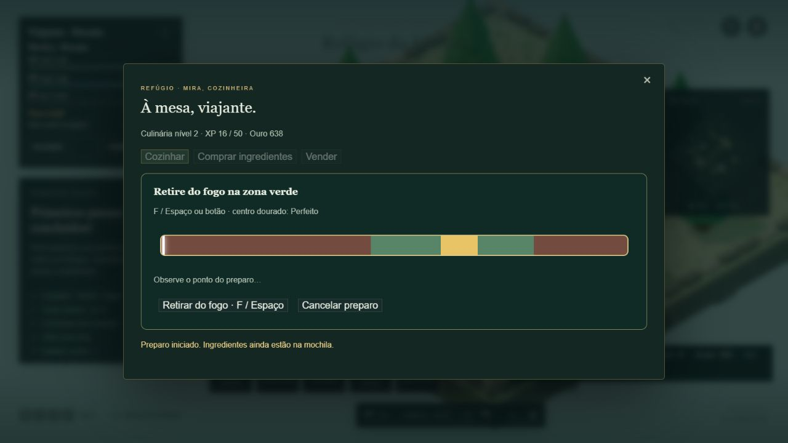
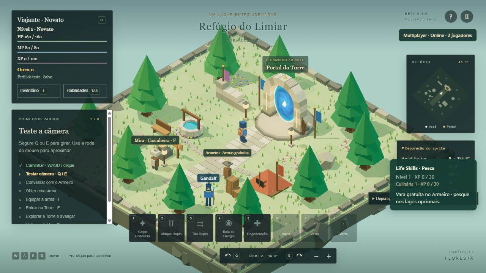

# Dungeon Teacher — Beta 0.6.4 (HUD Foundation)

A roguelite-ish tower climber (not a traditional roguelike) built with **Three.js (3D, orthographic camera)**, inspired by Ragnarok Online's dungeon loop. You pick a weapon at the Refuge, climb a procedurally generated tower fighting for XP and a boss chest, gather resources (fishing, cooking, mining, smithing), and return to the Refuge to level up, learn skills and gear up before going back in stronger.

**Design intent that is not built yet:** the educational layer (opening a chest triggers a question; answering correctly shifts the odds toward better loot) and chest rarities. Today a chest simply grants one equipment piece and some gold. Everything below describes what the code actually does; the final section lists what does not exist.

> **Original integrated art, as of 0.6.0:** player, six townsfolk, six matching portraits, three Slime types, the White Wolf and the Oath Knight boss, plus a shared city with original environment textures. 0.6.1–0.6.4 focused on performance and shared HUD, not new art. This is a provisional visual direction. WebGL 2 and graphics acceleration are required; school hardware and mobile have not been validated.

## Status

**Beta 0.5.1 is the last packaged, exportable installer.** Everything from 0.5.2 onward (including this 0.6.4 source) has been validated with automated tests and local Electron runs, but has not been repackaged into a new installer yet.

| Build | State |
|---|---|
| **0.6.4 HUD Foundation** (current source) | Shared HUD foundation (HP/MP/XP/level, eight hotbar slots); exploration panels close on a confirmed hit (including zero damage) with safe focus recovery; registered Tower panels block controls without pausing the simulation; consumption confirmation/rollback preserves damage/progress received mid-save. [Iteration 24.1 report](docs/ITERACAO-24.1-RELATORIO.md). |
| 0.6.3 The Last Stutters | Cooperative shader submission with overlapping, cancellable GPU waits; atlas/pose preparation finishes before first render; limited diagnostic capture of outliers, no continuous profiler load. [Iteration 23.3 report](docs/ITERACAO-23.3-RELATORIO.md). |
| 0.6.2 The Tower Without Waits | Cooperative scene building with stale-destination cancellation; async shader prep with GPU warmup limited to the first frame; visual waiting/recovery pass for failures and reconnects; limited anticipation of the Guardian's public atlas near the door. [Iteration 23.2 report](docs/ITERACAO-23.2-RELATORIO.md). |
| 0.6.1 The Tower Without Stutters | Persistent F10 diagnostics with local export and tail-latency metrics; graphics profiles with automatic/manual adjustment and hysteresis; renderer reuse across transitions; conservative navigation obstacle clipping. [Iteration 23.1 report](docs/ITERACAO-23.1-RELATORIO.md). |
| 0.6.0 Knight of the Last Oath | Simultaneous private arenas on floor 3; new boss (sword, arcane wave, circular burst, charge, second phase); global 32-connection cap; 300 XP and permanent floor-4 unlock granted once, on the first win only. [Iteration 23 report](docs/ITERACAO-23-RELATORIO.md). |
| 0.5.2 A Torre Desperta | Shared population 30/55/70, conservative respawn, optional underground White Wolf encounter, persistent tomb and private loot, floor-three fortress. [Iteration 22.2 report](docs/ITERACAO-22.2-RELATORIO.md). |
| **0.5.1 Um Mundo Vivo** (last exportable installer) | Open terrain on floors 1–3, layered ruins and stairs, ambient townsfolk, revised walking/mining/fishing presentation. [Iteration 22.1 report](docs/ITERACAO-22.1-RELATORIO.md). |
| **0.5.0 A Torre Viva** | Additive expansion of floors 1–3, original forest art, grounded wolves, safe server respawn and larger NPCs. [Iteration 22 report](docs/ITERACAO-22-RELATORIO.md). |
| 0.4.3 Animation Coherence | Five full-body walk frames per direction and equipment state, illustrated tools/projectiles, consistent NPCs and contextual enemy hover. [Iteration 21.2 report](docs/ITERACAO-21.2-RELATORIO.md). |
| 0.4.2 Visual Polish | Integer padded atlases, four alternating walking frames per direction, integrated weapon draw/combat/sheath, city walls and continuous forest exterior. [Iteration 21.1 report](docs/ITERACAO-21.1-RELATORIO.md). |
| 0.4.1 City and HUD | 60 × 56 city with seven districts in both modes, corrected player atlas, four equipment visuals, shared compact HUD, profession book and persistent configurable hotbar. [Iteration 21 report](docs/ITERACAO-21-RELATORIO.md). |
| 0.4.0 School Demo Foundation | Shared city, original sprites and portraits, NPC dialogue, readable combat, twelve-client integration and sustained measurements. See the Iteration 20 report. |
| 0.3.0 Social Multiplayer | Persistent online characters, six-player parties, cooperative XP, manual individual loot and global/party chat. Automated validation; human playtest pending. |
| 0.2.2 Shared Tower | Twelve persistent procedural floors, adjacent portals, idle-area suspension. 516 automated tests passed; two Electron clients; human playtest pending. |
| 0.2.1 Shared Tower | Procedural floors 1/2, persisted geography, server-validated portals, per-floor populations and v3 area epochs. Automated local validation; human playtest pending. |
| 0.2.0 Shared World | Server-authoritative test map, temporary characters, shared monsters, basic combat and isolated Electron test profiles. Local automated and two-process Electron checks; public deployment and human playtest still pending. |
| 0.1.5 Smithing | Forge station, hammer minigame, forged weapons, Smithing life skill. Marked as manually playtested and approved by the project owner. |
| 0.1.4 Tower Progression | Campaign beyond floor 3, new biome sequence, cleared-floor memory, boss continuation. Approved in manual playtest on 2026-10-09. Installer in `release/tower-progression-playtest/`. |
| 0.1.3 Mining, 0.1.2 Cave biome | Mining life skill and caves. Installers in `release/mining-playtest/` and `release/cave-biome-playtest/`. |

The 0.1.5 installers were generated in a temporary working copy and are **not** in `release/`. The packaging command `npm run desktop:package:playtest` now targets 0.5.0; rebuilding the historical 0.1.5 requires its original source revision.


## Beta 0.5.0 — A Torre Viva

Os andares 1–3 ganham dois circuitos laterais, árvores ilustradas, vegetação, poças rasas e ruínas. Lobos terrestres complementam os Slimes; no andar 1 são passivos, nos seguintes percebem jogadores próximos com linha de visão. Online, Slimes reaparecem após 24 s e lobos após 32 s, aguardando 6 unidades de afastamento dos jogadores. A campanha mantém inimigos derrotados ausentes durante a run.

A expansão v1 é aplicada ao carregar a geografia original: **não modifica `floor-N.json`**. IDs, portais, perfis e andares 4–12 são preservados. Não há novo chefe. Os seis NPCs usam escala visual 1,5×. Habilidades e animações do protagonista não foram reconstruídas.

[Relatório, limitações e evidências](docs/ITERACAO-22-RELATORIO.md). Não houve deploy nem geração de instalador.

## Beta 0.4.3 — animações e identidade visual

Cinco passos por direção e estado, idles próprios e transições completas para espada, arco, duas adagas e cajado. Equipamentos ilustrados integrados, ferramentas ligadas às ações reais, efeitos das cinco habilidades existentes e NPCs com retratos preservados. Nomes de inimigos aparecem somente sob o ponteiro, com cursor de espada. Saves e regras de jogo preservados. [Relatório e evidências](docs/ITERACAO-21.2-RELATORIO.md).

## Beta 0.4.2 — polimento visual (histórico)

Atlas reconstruídos com células inteiras e margens transparentes. Quatro passos alternados por direção, cadência por distância percorrida e continuidade entre snapshots. Espada, arco, duas adagas e cajado possuem poses próprias: saque automático, postura armada e guarda após cinco segundos sem ação hostil/dano. Tempos e regras lógicas de combate não mudaram.

Cidade com muralhas, torres, portões fechados e exterior contínuo de floresta, relevo e estradas. Rótulos de bairros removidos; placas físicas e nomes de NPCs por proximidade. Câmera, HUD e hotbar preservados.

Validação: 544/544 na suíte completa serial, mais 11/11 focados após ajustes finais; build aprovado e dois Electron reais. Benchmark com 12 personagens: 77,17 FPS parados, 65,61 em movimento, servidor próximo de 20 Hz. A nova cidade custa cerca de 14% na janela parada frente à 0.4.1; PCs da escola ainda não testados.

[Relatório](docs/ITERACAO-21.1-RELATORIO.md), [vídeos e capturas](docs/ITERACAO-21.1-CAPTURAS.md), [desempenho](docs/ITERACAO-21.1-DESEMPENHO.md). Sem novo instalador, publicação ou reset do save. As seções abaixo preservam o histórico das versões anteriores.

## Beta 0.4.1 — cidade, personagem e interface

A cidade passou de 34 × 32 para **60 × 56 unidades**, com praça, mercado, oficinas, residências, santuário, caminho da Torre e taverna. A campanha local usa a mesma planta e arte, com adaptador para o Armeiro, cozinha, forja e portal da campanha. O servidor preserva as ações online, personagens e andares persistidos; posições antigas não são importadas para dentro de edifícios.

**Menus**, no canto superior direito, abre inventário, equipamentos, atributos, habilidades, profissões, party, diário, configurações e ajuda. O personagem ocupa um painel compacto no canto superior esquerdo; HP, MP e XP têm cores distintas. Não há Job Level fictício. Chat, mensagens e party são recolhíveis.

**Hotbar:** oito atalhos, teclas 1–8. Use **Configurar atalhos** para escolher a posição e uma habilidade aprendida, limpar um slot ou trocar posições. Arrastar um slot sobre outro também troca a posição. No livro de habilidades, **Colocar na hotbar** abre a configuração. Os atalhos locais são salvos com o personagem; falhas de gravação revertem a alteração. Trocar a arma não apaga o atalho: o requisito da habilidade continua sendo verificado.

**Diferenças entre modos:** habilidades ativas, profissões, cozinha e forja continuam funcionais na campanha. O servidor online ainda oferece combate básico; a interface informa a indisponibilidade das habilidades ativas e não envia comandos inventados. Preferências de hotbar online usam a identidade autenticada e um espaço de armazenamento separado do save local. O livro de profissões mostra níveis e XP locais reais; no online, informa a indisponibilidade.

O personagem usa um atlas de 8 × 4 células, com caminhada a 4,5 quadros por segundo e poses de ação, dano e derrota. Espada, adaga, arco e cajado são representados separadamente do corpo; ferramentas de profissão permanecem na mochila. A direção visual não altera a direção lógica ou as regras de combate.

Validação reproduzível: `npm test`, `npm run build`, `node scripts/world-electron-probe.mjs --iteration21`. O benchmark existente aceita `DIAGNOSTIC_CLIENT_ONLY=1`, `DIAGNOSTIC_CITY_MOVING=1` e `DIAGNOSTIC_SECONDS=30` para comparar cidade parada, movimento contínuo, Torre e efeitos. Consulte resultados, condições e capturas no [relatório da Iteração 21](docs/ITERACAO-21-RELATORIO.md). Nenhum instalador ou deploy foi produzido nesta iteração.

## Beta 0.4.0 — cidade compartilhada e preparação da demonstração

Novos personagens online começam na **Cidade do Limiar**. Personagens existentes continuam no andar salvo; use o portal da entrada do andar 1 para retornar à cidade. F entra na Torre ou utiliza os portais. Clique em um morador próximo para conversar, avance com **Continuar** e encerre com **Fechar** ou Esc.

Serafina (Anjo do Reset), Marta (Armazeneira), Brasa (Ferreiro), Lina (Cozinheira), Orin (Mago das Poções) e Caio (Guia da Torre) têm sprites, retratos e falas próprios. Serviços online ainda não implementados são descritos como futuros. A campanha local e seus serviços continuam separados; seus saves não são apagados ou convertidos.

A cidade usa geometria compartilhada e colisões no servidor. Há praça com fonte, ruas, casas, oficina, taverna, loja de poções, armazém, área do Anjo, portal, jardins, árvores, barracas, cercas, iluminação e placas. Sprites de jogadores e Slimes, barras de HP, impactos, números de dano e feedback de XP/saque refletem os estados e eventos existentes.

```powershell
npm run desktop:build
npm run server:start
# Em outros terminais:
npm run desktop:test:a
npm run desktop:test:b
# Validações automatizadas com dados isolados:
npm run test:school
npm run test:school:electron
npm run test:school:soak
```

O teste sustentado dura pelo menos 30 minutos por padrão. `SOAK_SECONDS` permite ensaios curtos, que não substituem essa evidência. O servidor roda em processo separado dos 12 clientes WebSocket e salva métricas em `.logs/school-<timestamp>/report.json`. A suíte Electron usa dois processos reais e dez sockets adicionais para medir uma cena com 12 personagens; isso **não equivale a 12 PCs Electron**. A frequência nominal é 20 ticks/s; consulte o relatório para a frequência efetivamente medida e as limitações.

Limites padrão: 16 conexões por IP, 16 jogadores por área e 32 tentativas de conexão por janela de 10 segundos, permitindo uma turma e reconexões sem retirar as proteções de taxa. Persistência mantém o esquema SQLite 1 e acrescenta apenas `area: "shared-city"` ao estado quando o personagem está na cidade. Registros antigos e arquivos dos andares permanecem válidos.

[Relatório completo e métricas](docs/ITERACAO-20-RELATORIO.md) · [Pipeline, atlas e criação das artes](docs/ITERACAO-20-ARTES.md). Nenhum deploy, publicação, commit ou novo instalador foi realizado nesta iteração.

## Beta 0.3.0 — persistent social multiplayer

Two distinct online characters can form a party, chat, fight, share XP, manually collect private drops, level up, advance and return after a server restart with progress intact. Local campaign saves remain separate. The twelve public floors reuse the persisted geography; party membership never creates private maps or teleports players.

Use Node >=22.13 (Node 24 tested). Build with `npm run desktop:build`, then run in separate terminals:

```powershell
npm run server:start
npm run desktop:test:a
npm run desktop:test:b
```

A/B now use protocol **v4**, isolated profiles and OS-encrypted per-endpoint credentials. Names are display labels, not authentication. The right panel provides party invitations/management, global and party chat, XP, inventory and attributes. Click a nearby private drop to collect it; F uses portals. Allocate earned attribute points at the floor entrance, outside combat.

The server saves characters and pending drops in `data/online/characters.sqlite` (`CHARACTER_DATA_DIR`), using SQLite WAL/FULL transactions. Back up this directory while the server is stopped, together with `data/shared-tower/` (`WORLD_DATA_DIR`). Deployments require persistent volumes for both. Losing the encrypted client credential has no recovery flow in this beta. No plaintext credential fallback is allowed.

Party: six members, maximum 20-level spread at entry; temporary disconnects preserve membership. Server restarts preserve characters but clear parties/invitations. Shared XP requires eligible live, connected, nearby members in the same floor, with a qualifying contributor. Provisional radius: 12 units; bonus: 10% per additional eligible member. Manual loot uses one existing Raw Ore item as a test reward, private for five minutes. Full formula, rounding, membership changes and limits are documented in the report.

Validation: **526/526 full-suite tests**, plus the final nine-test focused run (one additional case), build and two real Electron clients. The integrated network test reached level 2, collected items, advanced, restarted the server and recovered progress. Seven sockets verified the party limit and channel isolation. No human playtest, WAN/load test, Docker execution, deployment or new installer.

This is a controlled experimental beta. Friends/private messages, definitive accounts, public bosses, online professions and economy remain pending. Death return and the inherited level-100 limit remain provisional; the complete GDD is not implemented.

[Iteration 19 report, architecture, rules and evidence](docs/ITERACAO-19-RELATORIO.md). [Invitation](screenshots/beta030-invitation.png), [inventory](screenshots/beta030-inventory.png), [chat between floors](screenshots/beta030-chat.png).

```powershell
npm run test:online
npm run test:online:electron
npm run desktop:test:temporary
npm run desktop:test:legacy
```

Protocols v1/v2/v3 remain supported in their legacy modes. Persistent characters currently require Electron; browser temporary mode remains available.

## Beta 0.2.2 — legacy temporary Tower (v3)

Floors **1 through 12** reuse the campaign generator, including forest/cave biomes, trails, obstacles and optional regions. Each floor owns its players, monsters and events. Gates remain open for experimental access; floors 3/6/9/12 use existing normal encounters, without public bosses or permanent rewards.

Build once with `npm run desktop:build`, then run each command in a separate terminal:

```powershell
npm run server:start
npx electron . --test-profile=A --temporary-tower
npx electron . --test-profile=B --temporary-tower
```

Press **F** near the final portal to ascend, or the entrance portal to descend. The final portal on floor 12 announces that floor 13 is unavailable. Server validation rejects arbitrary destinations and stale visits.

Geography remains in `data/shared-tower/`, configurable with `WORLD_DATA_DIR`. Existing 0.2.1 files are preserved byte for byte: current portal destinations are applied to an in-memory copy. New files use adapter generation version 2; unknown/corrupt files are preserved and rejected. Back up the directory. Atomic publication requires hard links; Docker needs a persistent volume at `/app/data/shared-tower`.

Empty areas suspend simulation once no reconnecting sessions remain. Visited areas stay in memory; no permanent player progression is saved. Local campaign and real IndexedDB saves remain independent. A/B use isolated test profiles.

Protocols v1/v2 remain supported; the Tower still uses v3. Older 0.2.1 clients need updating to accept floors above 2. The legacy arena commands below remain available. No public server deployment or installer was made.

Validation: **516/516 tests**, build, real WebSocket traversal/restart, and two real Electron processes rendering all twelve floors. Human playtest, WAN, load, Docker and installers remain untested. Build retains the existing large-chunk warning.

[Iteration 18 report, file list, performance and limitations](docs/ITERACAO-18-RELATORIO.md). [Forest screenshot](screenshots/beta022-floor4.png), [cave screenshot](screenshots/beta022-floor7.png), [floor-12 limit](screenshots/beta022-floor12-limit.png). Historical [Iteration 17 report](docs/ITERACAO-17-RELATORIO.md).

```powershell
npm run test:tower
npm run test:multiplayer
npm run test:tower:electron
```

## Beta 0.2.0 — legacy shared-world test

The server owns movement, collision, monster AI/targets, basic attack timing/damage, HP, death and respawn. Clients send intentions and render snapshots. One server process and the existing /hub endpoint serve both protocols. Local campaign, skills, inventory, Mining, Smithing, Fishing and Cooking remain available.

Requirements: Node 22.12+, dependencies installed with `npm ci` and `npm run server:install`; Electron installed by npm. From the repository root, build once:

```powershell
npm run desktop:build
```

Open three terminals in the repository:

```powershell
# Terminal 1 — server
npm run server:start
# Terminal 2 — client A
npx electron . --test-profile=A --legacy-world
# Terminal 3 — client B
npx electron . --test-profile=B --legacy-world
```

These commands select `ws://127.0.0.1:8787/hub` and independent profiles under `%APPDATA%\Dungeon Master Tests\A` and `B`. The normal `%APPDATA%\Dungeon Master` profile is unchanged. The shared entry point never opens IndexedDB. It uses server-issued temporary swords/attributes and grants no permanent XP, gold or loot.

Click a Slime to approach and auto-attack; WASD or floor click cancels the attack. Q/E, mouse-wheel and middle-button orbit are retained. Menus/blur stop your input, not the server. Monster respawn takes at least six seconds and waits until its origin is clear. Player return takes four seconds. Use Disconnect/Connect to test reconnection.

For an explicitly configured remote test server, use:

```powershell
npx electron . --test-profile=A --legacy-world --server=wss://YOUR-DOMAIN/hub
npx electron . --test-profile=B --legacy-world --server=wss://YOUR-DOMAIN/hub
```

The remote server must run the 0.2.0 source. **The existing public Render service was not deployed or validated for v2 in this iteration.** The campaign button uses the configured endpoint; use the local commands above for this delivery. Electron keeps its exact endpoint allowlist and accepts unencrypted WebSocket only on loopback.

Validation, file list, architecture, known limits and manual checklist: [Beta 0.2.0 report](docs/BETA-0.2.0-RELATORIO.md). [Changelog](CHANGELOG.md). No new installer was generated; the source-based Electron commands are the validated launch path.

## Screenshots
*(placeholder art — not final visuals)*

| Hub — Refúgio do Limiar | Boss fight |
|---|---|
|  |  |

| Choosing a weapon/class | Skill tree |
|---|---|
|  |  |

| Cooking minigame | Multiplayer (2 players in the Hub) |
|---|---|
|  |  |

## Play

With the dev server running, open **http://127.0.0.1:5173/**. On Windows run `INICIAR-JOGO.cmd` and keep its window open. First install on another machine: Node.js 22.12+ (or 24+), then:

```sh
npm ci
npm run dev -- --port 5173 --strictPort
```

Do not open `index.html` by double-clicking: the modules need the server. There is no account system; the Node server supports Refuge presence and the 0.2.0 shared combat test map (see below) and nothing is fetched from a CDN at runtime.

### Controls

| Action | Control |
|---|---|
| Walk | WASD or arrow keys, relative to the camera |
| Walk to a point (pathfinding) | Click on the ground |
| Select an enemy and attack it | Click the enemy |
| Cancel path / action | WASD or Esc |
| Interact (NPCs, portals, chests, fishing spots, veins, forge) | F, or the highlighted action button |
| Minigames (pull the line, pickaxe swing, hammer, take dish off the heat) | F or Space |
| Skills | Keys 1–8 or click the hotbar |
| Inventory and equipment | I |
| Character and attributes | C |
| Skill tree | TAB |
| Help | H or the ? button |
| Pause | Esc with no active path/action, the top button, or leaving the window |
| Rotate camera | Hold Q / E or the bottom buttons |
| Orbit with mouse | Hold the middle button and drag horizontally |
| Zoom | Mouse wheel, + / − or the bottom buttons |

### URL parameters (development)

| Parameter | Effect |
|---|---|
| `test=1` | Uses a separate save profile, so the normal character is untouched |
| `debug=1` | Debug panels (sprite, run seed/floor/environment, combat debug, inspection buttons, test tools in C) |
| `seed=<n>` | With `debug=1`: fixes the run seed so a tower can be reproduced |
| `stress=1` | With `debug=1`: spawns twenty enemies per floor |
| `perf=1` | FPS and p95 frame interval sample |

Only `?debug=1` applies test actions to the normal profile; `?debug=1&test=1` is the safe way.

## The game loop

1. **Refuge** (safe hub): talk to the Armorer, take a free weapon, equip it (I), optionally take the fishing rod and buy a pickaxe, cook with Mira, forge weapons, open chests, distribute attribute points (C), learn skills (TAB).
2. **Portal → Tower floor 1.** Each floor is a chain of regions connected by trails. Two required encounters per floor seal the way forward with a barrier; defeating those enemies opens it. Optional detours (lakes, ruins) give extra XP and resources.
3. Reach the exit arch to **climb** to the next floor. Floor 3 holds the **Guardian** (boss). Defeat it, take its chest, then choose to **climb** (floor 4 and beyond, up to floor 50) or **return** to the Refuge.
4. Dying, or abandoning at the floor's entrance, sends you back to the Refuge with full HP/MP. Items and XP already obtained are kept. Reloading also starts at the Refuge; an expedition in progress is never restored.
5. Resources gathered in the tower (fish, ore) feed Cooking, Smithing and the economy.

First-time guidance is a 9-step "Primeiros passos" panel: walk, rotate camera, talk to the Armorer, get a weapon, equip it, enter the Tower, clear a floor, return to the Refuge, learn a skill.

## Systems reference

### Time and simulation

- The simulation runs at a **fixed 30 Hz** step (`tick = 1/30 s`), with at most **5 catch-up ticks per rendered frame**. Rendering, input and UI are decoupled from it.
- Opening any panel or dialog **pauses** the simulation (skills, cooldowns, regeneration, enemies, fishing and mining). Losing window focus also pauses.
- Minigame clocks differ: fishing and mining run in simulation time; the **Cooking** meter uses the wall clock; the **forge** advances by the frame delta (clamped to 0.1 s per frame, so a hidden window cannot fail an attempt).
- Player speed 3.6 units/s, body radius 0.32, navigation grid cell 0.5.

### Character, HP and MP

There is a single class, **Novato** (no modifiers). Six attributes start at **5** each and are capped at 999:

| Attribute | Effect |
|---|---|
| STR (Força) | Physical attack, carry capacity |
| AGI (Agilidade) | Attack speed, evasion |
| VIT (Vitalidade) | Max HP, physical defense, HP regeneration |
| INT (Inteligência) | Magic attack, max MP, magic defense, MP regeneration |
| DEX (Destreza) | Accuracy, a little physical attack |
| LUK (Sorte) | Critical chance |

Derived stats (`calculateStats`, level `L`, attributes `str…luk`, then equipment/food/other bonuses added, then clamped):

| Stat | Formula (base + attribute terms) | Clamp |
|---|---|---|
| Max HP | `100 + VIT·12 + (L−1)·8`, floored, min 1 | |
| Max MP | `40 + INT·8 + (L−1)·3`, floored | |
| Physical attack | `5 + STR·2 + DEX·0.5` | |
| Magic attack | `3 + INT·2.5` | |
| Physical defense | `2 + VIT·0.8` | |
| Magic defense | `2 + INT·0.7` | |
| Attack speed (attacks/s) | `1 · (1 + AGI·0.015)` | 0.25 – 4 |
| Accuracy | `75 + DEX·0.5` | 5 – 98 |
| Evasion | `2 + AGI·0.3` | 0 – 75 |
| Critical chance (%) | `3 + LUK·0.2` | 0 – 25 |
| Carry capacity | `100 + STR·3` | |
| HP regeneration (/s) | `0.5 + VIT·0.1` | |
| MP regeneration (/s) | `0.4 + INT·0.12` | |

A fresh character therefore has **160 HP, 80 MP**, 17.5 physical attack, 6 physical defense, 1.075 attacks/s, 77.5 accuracy, 3.5 evasion, 4% crit, 1 HP/s and 1 MP/s regeneration.

- **Current HP/MP** are saved with the character and clamped to the maximums whenever those change (levels, equipment, food buffs).
- **Regeneration** runs every simulation tick while alive, in or out of combat, at the rates above. It is saved consolidated every 2 seconds and on window blur/close; there is no offline regeneration.
- **MP** is spent when a skill *starts executing* (not when requested) and is not refunded on interruption. Fish, dishes and the Regeneration skill restore HP/MP.
- **Carry capacity is calculated and shown, but limits nothing yet**: the inventory is a fixed 32 slots.
- **Death:** all pending actions are cancelled, enemies return to their origins, and after 3 seconds you reappear at the Refuge with full HP and MP. The run ends; XP, gold and items are kept.

### Experience and levels

- XP needed for the next level: `100 + (L − 1) · 250`. Level cap 100.
- Each level grants **5 attribute points** and **1 Skill Space**. Attribute points are spent in C and only in the safe Refuge, out of combat; confirmed distributions are saved immediately.
- Sources: enemies (12 / 15 / 18 XP by floor depth, scaled further after floor 3), the Guardian (70 XP). Enemies drop **no gold**.

### Combat

**Targeting.** Click an enemy to select it. The character walks along an A* route to a point inside weapon range with a clear line of sight (`approach`), then auto-attacks. Moving manually, clicking the ground, Esc or a failed route cancels the pursuit. Attacks need an equipped weapon and are blocked while a life-skill activity (fishing, mining) is busy.

**Auto-attack cycle** (player and enemies use the same `AttackCycle`):

- Interval `1 / attackSpeed`. The first **25%** is wind-up, the impact happens at its end, the remaining **75%** is recovery.
- Cancelling during wind-up converts the remaining wind-up plus the recovery into a **recovery debt**, so spam-clicking cannot bypass attack speed.
- The attack only fires if, at impact time, the target is still valid and in range with line of sight.

**Hit, crit and damage** (`resolveAttack`, three random draws):

1. Hit if `random < clamp((accuracy − evasion) / 100, 0.05, 0.95)`. A miss does 0 damage.
2. Critical if `random < criticalChance / 100`.
3. `damage = max(1, round( max(1, attack − defense) · variation · (critical ? 1.5 : 1) ))`, with `variation` uniform in **1 ± 0.08**.

Physical attacks use physical attack vs physical defense; magical attacks (staff, Energy Ball, Magic Slime) use magic attack vs **magic defense**. Skill and attack `power` multiplies the attack stat before defense.

**Weapons** (the Armorer's free ones; equipment adds to the stat shown):

| Weapon | Damage stat | Auto-attack range | Delivery | Notes |
|---|---|---|---|---|
| Espada de Treino (sword) | +5 physical attack | 1.45 | Melee, heavy impact | |
| Adaga de Treino (dagger) | +3 physical attack, **+0.65 attack speed** | 1.35 | Melee, power ×0.72 | attacks about 1.7/s at start |
| Arco de Treino (bow) | +4 physical attack | 6 | Projectile, speed 12 | |
| Cajado de Treino (staff) | +6 magic attack | 6 | Magic projectile, speed 8 | |

Projectiles home in on their target, live at most 3 seconds, are stopped by static geometry and roll hit/crit/damage only when they arrive. Equipment cannot be swapped during combat.

### Skills and the action model (there is no multi-action queue)

**Learning.** Each of the five skills costs **1 Skill Space** and is independent (the "tree" is five unlocked nodes under Novato). The hotbar has **8 configurable slots** (keys 1–8). Without a saved preference, learned skills appear in their historical slots 1–5; unknown skills remain empty. The editor and drag-and-drop can reorder or clear learned skills.

| Skill | Needs | MP | Cooldown | Cast / recovery | Effect |
|---|---|---:|---:|---|---|
| Golpe Poderoso | sword | 8 | 4 s | 0.25 s / 0.45 s | One hit, power 2.2, range 1.45 |
| Ataque Duplo | dagger | 10 | 4 s | 0.12 s / 0.35 s | Two hits (at 0 and 0.18 s), power 0.9 each, range 1.4 |
| Tiro Duplo | bow | 12 | 5 s | 0.2 s / 0.35 s | Two projectiles (0 and 0.22 s), power 1 each, range 7 |
| Bola de Energia | staff | 14 | 5 s | 0.8 s / 0.4 s | One magic projectile, power 1.9, range 7 |
| Regeneração | any weapon | 14 | 10 s | 0.25 s / 0.3 s | Self: heal tick every 1 s for 6 s, each `6 + 0.15 · magic attack` |

**What happens when you press a skill key** (`AbilityRuntime`):

1. **Validation:** skill learned, alive, right weapon, valid enemy selected (for targeted skills), enough MP, and cooldown remaining no more than the **input buffer (0.3 s)**. Otherwise a message explains why (e.g. "MP insuficiente").
2. **One pending intent.** A valid request becomes the single `pending` intent. A newer request replaces it. It expires after **12 s**, or earlier if it becomes invalid.
3. **Approach.** If out of range, the character walks toward the target (`skillApproach`) until in range with line of sight.
4. **Start condition.** Execution begins only when the cooldown is over **and the auto-attack cycle is idle** (a swing in progress finishes first). At that moment MP is spent, the cooldown starts and the stats are snapshotted.
5. **Execution:** `casting` (cast time) → `usingSkill` (effects fire at `cast time + offset`) → `recovering` (recovery). Heading follows the target.
6. **After the skill:** if the skill needed a target or auto-attack was running, the character resumes chasing/attacking.

**Interruption.** Moving by keyboard, clicking the ground, Esc, losing the target, dying, or starting a life-skill activity cancels the pending/active skill. MP and cooldown are **not** refunded. A started periodic heal keeps ticking until it ends or you die. Hits on you cancel fishing and mining but not skills.

Other "queues" in the code, for completeness: the walking route is a list of waypoints from A* (any manual input clears it); each attacker has one attack cycle; periodic effects and projectiles are lists updated each tick.

### Enemies and AI

| Enemy | Role | HP (floor 3) | Speed | Notes |
|---|---|---:|---:|---|
| Slime de Treino | Melee | 120 | 2.6 | defense 4, attack speed 0.8, range 1.65, leash 6.5 |
| Slime Saltador | Melee, mobile | 90 (×0.75) | 4 | defense 2, attack speed 0.9, leash 8 |
| Slime Mágico | Ranged magic | 84 (×0.7) | 2.4 | magic attack 13, range 6, keeps ~4 units away, retreats when closer than 2.8, projectile speed 5 |
| Slime Guardião (boss) | Melee, scale 2 | 300 | — | attack 13, attack speed 0.65, range 1.8, detects and leashes at 100, gives 70 XP |

- **Per floor (difficulty = min(floor, 3)):** 3 / 4 / 5 enemies **in total** across the two required encounters (the first gets half, the second the rest), plus 2 in each optional detour region; base HP 80 / 100 / 120, attack 9 / 10 / 11, XP 12 / 15 / 18, multiplied by the type's HP scale. Floor 1 uses only Slime de Treino, floor 2 adds Saltador, floor 3 and beyond add Mágico. Composition is shuffled per seed.
- **After floor 3** (provisional, untuned): HP +3%, attack +2%, XP +2% **per floor**, capped at floor 50 (about ×2.4 HP, ×1.9 attack and XP).
- **Tower enemies are passive** (`aggressive: false`): they wander within 0.7–1.5 units of their spawn until they take damage. Only the Guardian is aggressive. They do not respawn during an expedition.
- **State machine:** `idle → alert (0.2 s) → chasing → attacking`. Detection range 3.2 (6 for Mágico) with line of sight; perception is checked every 0.18 s. Routes are replanned every 0.55 s or when the target moves more than 0.55.
- **Leash:** if the target stays beyond leash range + 0.6 for 0.9 s, or the enemy gets more than leash + 2 from its spawn, it gives up and enters `returning`. While returning it regenerates 30 HP/s, **cannot be selected or damaged**, and goes back to its spawn. If stuck for 2.5 s, or after 15 s, it snaps to the spawn.
- When the player dies, every engaged enemy returns. Enemies separate from each other, and the player can push bodies in contact.
- **Boss:** dormant until the floor's required enemies are dead **and** you are in its clearing; it wakes 2 seconds later.

### Items, inventory, chests and economy

- **Inventory:** 32 slots; items are `{instanceId, definitionId, quantity}`. Stackable resources stack to their max (99 for fish, ingredients, dishes and ore). **Equipment slots:** weapon, head, chest, legs, boots, ring, necklace, talisman.
- **Tools** (`fishingRod`, `simplePickaxe`) just need to be in the bag; they never occupy the weapon slot. The Armorer's weapons and the tools are unique (one per character).
- **Chest (Baú):** dropped by the Guardian, opened at the Refuge in I. The reward is fixed by the chest's seed: one of eight starter equipment pieces (equal weights; e.g. Capuz do Viajante +2 defense, Colete do Viajante +25 HP, Anel de Força +4 physical attack) plus **80–120 gold**. A reel animation shows it; Space slows it. The grant and the chest's consumption are saved together, and a free slot is required.
- **Gold sources:** chests and selling fish/dishes to Mira. **Sinks:** Mira's ingredients, the Simple Pickaxe (30 gold). Gold is capped at 1,000,000.

### The Refuge (hub)

A 24×24 safe area ("Refúgio do Limiar"): spawn, tower portal, a well, rest bench, a camp, ruins and trees.

| Place | What it does |
|---|---|
| **Armeiro** (Armorer) | Free weapons (one each of sword, dagger, bow, staff), the **free fishing rod**, and the **Simple Pickaxe for 30 gold**. Forged weapons are never listed here. |
| **Mira (Cozinheira)** and the **stove** | Cooking: recipes, buying ingredients, selling fish and dishes. |
| **Forja** (bigorna e brasas, between the Armorer and the portal) | Smithing, see below. |
| **Portal da Torre** | Starts a campaign run at floor 1 (needs an equipped weapon). |
| **Explorar biomas** (button) | Test tool, see below. |

Some hub zones (trade, storage, training, class orientation) are reserved in the data but have no function yet.

### Tower generation (procedural)

**Determinism.** Everything derives from the run seed with two small functions: `seedOf(string)` (FNV-1a 32-bit) and `seeded(seed)` (LCG with multiplier 1664525 and increment 1013904223). The same seed and floor always give the same floor. Independent streams keep systems from disturbing each other: `…:topology`, `…:decoration`, `…:geometry`, `…:encounter:<floor>`, `…:ambient:<id>`, `…:biome-sequence:v2`, `…:fishing-spots:<lake>`, `…:mineral-veins`, plus per-activity streams for fishing, mining and the forge. Changing one stream's consumers never alters the others.

**Biome sequence** (`src/world/biomes.js`). Floors are `FOREST`, `FOREST_TO_CAVE`, `CAVE` or `CAVE_TO_FOREST`. The chance that the *next* floor starts a transition depends on the number of pure floors since the run began (first transition) or since the last transition (recurring), with the last value a guarantee:

| Pure floors so far | First transition | After a transition |
|---:|---:|---:|
| 0 | 0% (floor 1) | 0% (the floor right after a transition is always a pure floor of the destination) |
| 1 | 0% (floor 2) | 10% |
| 2 | 50% (floor 3) | 50% |
| 3 | 75% (floor 4) | 75% |
| 4+ | 100% (floor 5) | 100% |

Directions are fixed (Forest → Forest-to-Cave → Cave → Cave-to-Forest → Forest), never two transitions in a row. *When* (`transitionChance`) and *where to* (`transitionTargets`) are separate decisions so more biomes can be added later. Exactly one random draw is made per floor.

**Floor graph** (`src/world/floor-graph.js`). `difficulty = min(floor, 3)`; the main path has `8 + difficulty` regions (+2 on transition floors): an entrance, an exit (or boss clearing), two `encounter` regions (at index 2 and `count − 3`), and `fork` / `grove` / `ruins` in between. Regions are placed along −Z (spacing `23 + difficulty`), alternating sides by 12–18 units, with radius 8–10 (10 for encounters, 12 for the boss clearing). Floor 1 has one optional detour (a lake pocket), later floors two (lake pocket, ruins); on floors 2 and above each detour has a 50% chance of one extra "tip" region. Trails join regions; trail radius 4 (floor 1) or 3.4 on the main path and 2.8 on detours, slightly narrower in caves. Each encounter region's outgoing trail carries a **gate** that opens when that encounter's enemies are dead.

**Materialization** (`src/world/tower.js`). Walkable terrain is the union of region disks and trail capsules. It adds cover rocks/pillars beside encounter and ruin regions, gates, enemy spawns (2 optional enemies per detour region), the exit portal and the abandon point at the spawn, water features and (in caves) mineral veins. Cave amount is a smoothstep of longitudinal progress from 20% to 80% of the floor, so transition floors blend gradually and in the right direction (Forest first for Forest-to-Cave, Cave first for the reverse); optional pockets inherit their zone.

**Validation and retries.** After generation the engine checks that every trail edge is walkable end to end, that every spawn is standable and reachable, and that the exit connects to the portal. A failed floor is regenerated with a fallback seed, up to 3 attempts, keeping the chosen biome.

**Water and fishing spots.** Lakes are ellipses (radius 2.5 × 1.8) at landmark points; only lakes in optional detours (not tips) are fishable, with one shore spot per lake chosen deterministically so it is dry, reachable and outside encounter regions.

**Mineral veins** (`src/world/mineral-veins.js`). Only on non-Forest floors and only where the terrain is already subterranean (cave amount ≥ 0.6). Target 3 per floor (max 4), spaced at least 6 units apart, preferring optional detours, never on corridors, in lakes, near the spawn/portal (8 units), enemies, interactables or inside encounter/boss regions, and each must stay reachable. They are solid rock with an interaction.

### Campaign progression

- **Boss floor.** Floor 3 always has the Guardian regardless of its biome (`floorRole` and `floorEnvironment` are independent). After it dies, a chest appears; the main portal ("Subir para o Andar 4") and a separate **refuge portal** ("Retornar ao Refúgio") both stay sealed until the chest is taken. Nothing starts by itself.
- **Beyond floor 3** floors are generated on demand from the run seed. The portal always starts at floor 1; there is no floor selection, teleport or checkpoint.
- **Floor 50** is the limit: its portal simply returns you to the Refuge. There is no final boss and no boss on other floors.
- **Cleared floors are remembered:** `character.tower.highestClearedFloor`. A floor counts as cleared the moment its challenges are resolved (floor 3: the Guardian is dead), and only in the normal campaign — entering a floor, debug teleports, stress mode and the biome explorer never advance it. The value is visible in C ("Maior andar concluído").
- **Revisits.** On a cleared floor the encounter gates are open and the exit is always usable, but **every enemy is still there**, still fights and still pays XP. The Guardian does not return; if you cleared floor 3 without taking its chest, the chest is offered once.
- **Unique reward.** The Guardian's chest is granted once per character (`claimedRewards: ['boss-floor-3']`), saved atomically with the item.
- **Explorar biomas** (Refuge button, needs an equipped weapon): starts directly at the first floor of the sequence with the chosen environment and continues with the normal sequence, up to floor 50, without boss or chest. It is a test tool; fishing and mining there still give their rewards, but it never touches campaign progress.

### Life skills

All four share the same curve: XP for the next level is `30 + 20·(L − 1)`, cap level 50. Each profession has its own level and XP, independent of combat and of each other.

**Fishing (Pesca).** Take the rod from the Armorer and stand at the marked shore of an optional lake (F). Cast (0.35 s), wait 1–3 s, then press F/Space within **1.2 s** of the bite. Early pulls fail, missed bites escape, and a spot calms for 2.5 s. Species by level: Lambari do Limiar (weight 55, 6 XP), Carpa dos Vaga-lumes (30, 8 XP), Bagre Musgoso (15, 10 XP) at level 1; Peixe-Lua (12, 12 XP) from level 2; Peixe Rúnico (5, 16 XP) from level 3. Taking damage, a hit, dying or changing area cancels the cast. The result is committed with one save; a failed save grants nothing.

**Cooking (Culinária).** At the stove or with Mira: six recipes (`roast`, `stew`, `carp`, `lunar`, `runic`, `catfish`), some gated by level, using fish and ingredients (Sal 2, Farinha 3, Ervas 4, Óleo 4, Água 1 gold). A 4-second meter: **PERFEITO** at 60–68% (XP ×1.5), **BOM** at 45–80% (×1), otherwise **ERRO** (×0.5). The dish is always produced; only XP changes. Eating is allowed out of combat with an **8-second shared cooldown**; one food buff (HP +30, attack +4, magic +4 or MP +20) lasts **5 minutes** and survives reload. Raw fish can be eaten too.

**Mining (Mineração).** Buy the Simple Pickaxe (30 gold). Near a vein (within 2.4) press F: 0.5 s preparation, then a marker sweeps the bar in 1.6 s; press F/Space in the zone (**PERFEITO** ±4% = 12 XP, **BOM** ±11% = 8 XP). A success gives **1 Raw Ore** and exhausts the vein for that floor; a miss costs nothing and retries after 1.5 s. 7 seconds without input is a miss. Esc cancels. Raw Ore stacks to 99, cannot be sold and is used by the forge.

**Smithing (Ferraria).** At the Forja, choose a recipe, then **Iniciar fabricação**: a short heating phase, then **three hammers**. Each hammer sweeps a bar (1.4 s, 1.2 s, 1.0 s) and F/Space must land in the bright zone: **preciso** ±5% (2 points), **aceitável** ±13% (1), **errado** (0, also if you do nothing). Score 5–6 is **PERFEITO**, 3–4 **BOM**, below that **FALHA**. Until the first hammer window opens you can close or cancel at no cost; after it the attempt always ends in a result. Every completed attempt spends the ore, yields exactly one weapon, grants Smithing XP (FALHA included) and counts as practice for that recipe; nothing is changed until the end and everything is saved in one transaction.

| Recipe | Raw Ore | XP FALHA / BOM / PERFEITO |
|---|---:|---|
| Espada Forjada | 3 | 3 / 8 / 12 |
| Adaga Forjada | 2 | 2 / 6 / 9 |
| Arco Forjado | 3 | 3 / 8 / 12 |
| Cajado Forjado | 3 | 3 / 8 / 12 |

A forged weapon is a copy of the Armorer's equivalent (range, delivery, speed, every other stat) with only the damage stat changed: **−1 / +1 / +2** for FALHA / BOM / PERFEITO, so FALHA < Armorer < BOM < PERFEITO (sword 4 / 5 / 6 / 7, dagger 2 / 3 / 4 / 5, bow 3 / 4 / 5 / 6, staff 5 / 6 / 7 / 8). They are named "Inferior", plain and "Superior", are not unique (several can coexist) and never grant attributes or effects. Practice is stored per recipe in `smithingMastery`; it is only recorded (no automation, no thresholds).

### Saves and persistence

- **Where:** the browser's IndexedDB, database `dungeon-master`, store `character`, key `current` (`iteration03-test` under `?test=1`), with a `…:previous` backup kept on each write.
- **Format:** `{saveVersion: '0.1.0', schemaVersion: 1, revision, savedAt, character}`. Derived stats are rebuilt on load; missing fields fall back to defaults (this is how new systems such as `tower`, `smithingMastery` and `lifeSkills.smithing` stay compatible with older saves). Invalid or future formats are never overwritten.
- **Progression version 4:** opening an older progression now stops with an explanatory error and preserves the original record. The historical automatic reset is disabled at the persistence entry point. No save format bump or automatic conversion in 0.2.0.
- **Writes** are serialized and revision-checked, so a second tab with an outdated revision is rejected instead of overwriting. Confirmed changes, rewards and transactions save immediately; regeneration is consolidated every 2 s and on window blur/close. The desktop build waits for pending transactions and saves before closing.
- **What is persisted:** attributes, level, XP, current HP/MP, gold, Skill Spaces and learned skills, inventory and equipment, the four life skills, food buff and cooldown deadlines, First Steps, tower progress and claimed rewards, smithing practice. **Not persisted:** the run in progress, floor layouts (always regenerated), vein state, cooldowns.

### Multiplayer — shared test map and legacy Refuge presence

The same Node/WebSocket server hosts **0.3.0 persistent social characters** (protocol v4), **0.2.1 procedural floors** (protocol v3), the **0.2.0 authoritative test map** (protocol v2 in `shared/world.js`) and preserves protocol v1 (`shared/multiplayer.js`) for **Refuge presence**: name, a local identity UUID and movement state (x, z, heading, moving) at up to 15 Hz, interpolated with 100 ms. In the legacy v1 Refuge mode, inventory, gold, combat, life skills and progress remain local; tower sharing is provided separately by v3. The v1 client connects only when asked (Multiplayer panel), leaves while you are in the Tower and reconnects on return. The server enforces origin, payload size (8 KB), rate and connection limits, heartbeat and a room capacity (default 16, up to 32). The distributed builds point at a public WSS endpoint configured in `config/multiplayer.json`; a free host may take about a minute to wake on first connection.

### Windows desktop build

The same web game packaged with **Electron 44.5.1** and **electron-builder 26.15.3** (NSIS installer plus Portable, x64, unsigned). The renderer loads `dungeon://game/index.html` from the ASAR with a strict CSP; only the configured WSS endpoint is allowed on the network, permission prompts are denied and downloads blocked. The profile lives in `%APPDATA%\Dungeon Master` and is shared by installer and portable. The window closes only after pending saves finish.

## Code map

| Path | Responsibility |
|---|---|
| `src/core/` | Configuration (tick, camera, speeds), hub validation, orbit camera state |
| `src/domain/` | Rules without rendering: `character/` (attributes, stats, balance), `combat/` (attack cycle, hit/damage), `abilities/` (definitions, effects, skill tree), `enemies/` (types, encounters, spawns), `items/` (catalog, inventory, loot, chest), `fishing`, `food`, `food-service`, `mining`, `shop`, `smithing`, `smithing-service`, `life-skills`, `tower-progress`, `expedition`, `first-steps`, `random` |
| `src/world/` | Geometry and generation: `biomes`, `floor-graph`, `tower`, `collision`, `navigation`, `water-features`, `mineral-veins` |
| `src/simulation/` | Runtime state: `game` (movement), `combat`, `abilities` (action model), `enemy-ai`, `bodies`, `areas` (hub/tower sessions, travel, progression), `interaction`, `fishing`, `mining` |
| `src/adapters/` | `rendering/` (Three.js scene, forest/cave, sprites, visuals), `input/`, `persistence/` (IndexedDB save), `desktop/` |
| `src/ui/` | HUD and panels (inventory, skills, character, kitchen, forge, rewards, biome explorer, multiplayer, fishing/mining HUDs) |
| `src/data/` | Hub JSON and enemy spawn data |
| `src/multiplayer/` | Browser-side client, identity and interpolation |
| `shared/` | Multiplayer protocol shared by client and server |
| `server/` | WebSocket presence server and `DEPLOY.md` |
| `desktop/` | Electron main process, protocol, network allowlist, preload; player-facing `LEIA-ME.txt` and playtest checklists |
| `tests/` | 20 test files (`node --test`), 490 tests |
| `docs/` | Iteration prompts and reports, specs and measurements |
| `scripts/` | Performance benchmarks, multiplayer verification and the public hub probe |
| `release/` | Generated installers (ignored by Git) |
| `sources/` | Read-only reference material; never modified |

Combat and skill rules live in the domain and simulation layers; the renderer only presents them.

## Development and verification

```sh
npm test                       # all tests, Node's native runner, no browser needed
npm run test:multiplayer       # protocol, server, client and security tests
npm run build                  # static build into dist/
npm run preview -- --port 4173 --strictPort
npm run desktop:dev            # build and open the Electron shell
npm run desktop:package        # NSIS + Portable (release/<output from electron-builder.yml>)
npm run desktop:package:playtest   # same, but first requires a public WSS endpoint
npm run server:install && npm run server:start   # local multiplayer backend
npm run multiplayer:configure -- wss://YOUR-DOMAIN/hub
```

- The build's bundle-size warning is known and does not block the build.
- `node scripts/iteration08-performance.mjs` (and 09, 10) reproduce the synthetic simulation benchmarks, separate from graphics measurement.
- The CSP test needs `dist/` to exist (`npm run build` first).
- Close any executable running from the output folder before packaging again.
- Do not run migrations against the real desktop profile; use a temporary profile for tests.

## Not implemented / known limits

- **Educational layer** (questions on chests, rarity-weighted rewards) and chest rarities.
- **Classes** beyond Novato; **a full economy**; a marketplace.
- **Bosses** other than the floor-3 Guardian; a final boss at floor 50; boss every five floors; checkpoints and floor teleport; persistent floor layouts; party/tower multiplayer; PvP.
- **Life skills:** metals and bars, alloys, modular components, refinement, per-recipe automation by mastery, selling Raw Ore; Mining and Smithing have no level-gated content yet.
- **Carry capacity** has no effect; the Refuge's reserved zones (trade, storage, training, class orientation) are empty.
- **Balance beyond floor 3** is provisional and untuned.
- All art is placeholder; mobile is not validated; the executable's native window and installation flow have only had assisted validation.

## Documentation

This README describes the game **as the code works today**. The history of how it got here lives in:

- **[`RELATORIOS.md`](RELATORIOS.md)** — the diary of every iteration, in order, with the text the README used to have about each one, and the previous README in full.
- `docs/` — each iteration's prompt, report and test/build logs (`ITERACAO-NN-RELATORIO.md`, `DESKTOP-01-…`, `MULTIPLAYER-01…`).
- Foundation documents: [technical plan](docs/PLANO-TECNICO-BETA-0.1.0.md), [foundation decisions](docs/DECISOES-FUNDACAO.md), [progression guidelines](docs/DIRETRIZES-DE-PROGRESSAO.md), [first steps](docs/PRIMEIROS-PASSOS.md) and the preserved [original spec](docs/ESPECIFICACAO-ORIGINAL-BETA-0.1.0.txt).
- Player-facing instructions for installers: `desktop/LEIA-ME.txt` and the `desktop/CHECKLIST-*.txt` playtest checklists. Backend deploy steps: `server/DEPLOY.md`.

